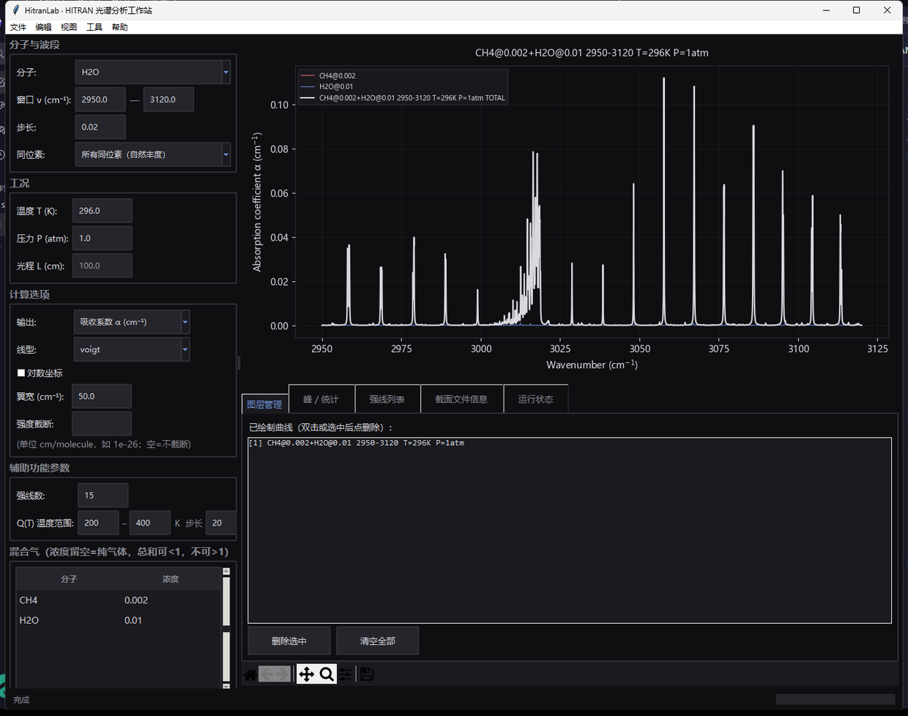
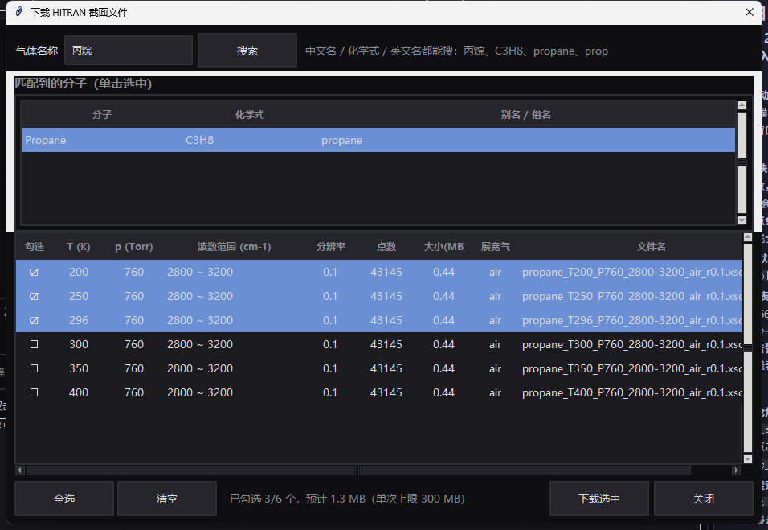

<div align="center">

<h1>hitran-mcp</h1>

<p><b>An AI toolchain for the HITRAN spectroscopic database: MCP server + HitranLink desktop workstation</b><br>
Retrieval · spectral calculation · plotting · provenance in one pipeline. Data is fetched live from HITRANonline via the official HAPI; the repository ships no data files.</p>

<a href="LICENSE"></a>
<a href="https://github.com/LKF0402/hitran-mcp/releases/latest"></a>
<a href="https://github.com/LKF0402/hitran-mcp/releases"></a>


<a href="https://github.com/LKF0402/hitran-mcp/stargazers"></a>
<a href="https://github.com/LKF0402/hitran-mcp/issues"></a>


[](https://github.com/LKF0402/hitran-mcp/actions/workflows/ci.yml)

</div>

[English](./README.en.md) | [中文](./README.md)


## 🚀 Quick start

**Two ways to use the toolkit; choose one.**

| Path | Prerequisite | Setup |
|---|---|---|
| 🤖 **AI-assisted setup** (recommended) | An AI client that can run commands locally | One conversation |
| 🖥️ **Desktop build** | Windows x64, no Python | Extract and run |

### 🤖 A · Give this instruction to your AI assistant

> Requirement: the assistant can execute commands on this machine (Claude Code / Cursor / Codex / Cherry Studio local mode, etc.).

```text
I use hitran-mcp (a HITRAN spectroscopy toolkit) on this machine. Please complete installation and self-check in this order:
1. Check whether Python is >= 3.10; if not, tell me which version to install and do not modify anything else on the system
2. Clone https://github.com/LKF0402/hitran-mcp into a fixed directory (update it if it already exists), then run pip install -r requirements.txt there
3. Run python tools/hitran_mcp.py --selftest and return the result verbatim
4. If your environment supports MCP client configuration, register it as an MCP server as described in the repository README section "MCP Client Setup"; if not, skip it and use the CLI entry point python tools/hitran_cli.py
5. Verify with one CLI run: python tools/hitran_cli.py t_spectrum --name CH4 --mole_frac 0.002 --numin 2950 --numax 3100 --T 296 --P 1.01325
6. Finish with three sentences: which calculations I can request in natural language, where the data cache lives, and what to check when a run fails
```

After installation, calculations can be requested directly in natural language, for example: **"Compute and plot the CH4 absorption spectrum around 2968 cm⁻¹."**

### 🖥️ B · Desktop build (no Python required)

[**⬇️ Latest release**](https://github.com/LKF0402/hitran-mcp/releases/latest) → extract → run `HitranLink.exe` → select molecules and parameters → click "Compute & Plot".

> 💡 **MCP is optional**: when the client can run local commands, the AI can call `python tools/hitran_cli.py ...` directly — same engine, same results. Only a pure web-chat environment requires MCP.

## 📸 Preview

**HitranLink desktop workstation** — CH4 + H2O mixture absorption spectrum (CH4 2000 ppm, H2O 1%, 296 K, 1 atm):



**Cross-section online search & one-click download** — fuzzy match by name, tick the T/P cases, download in batch:



## ✨ Features

| Feature | Description |
|---|---|
| Full pipeline | Species lookup → line-table fetch → strong-line list → absorption/transmittance spectrum → plot → partition sum → cross-section analysis |
| Dual-database bridge | LBL via HAPI online API; XSC (600+ heavy molecules) via official-API discovery + one-click download (no Portal login), or local file ingestion — unified output pipeline |
| Physical safeguards | Mixtures computed as `α_i = x_i · α_pure_i(T, P, bath)`; windows not covered are auto-refetched; zero-line/failure raise explicit errors instead of silently returning a flat spectrum |
| Full provenance | Every CSV/PNG carries HITRAN2024 + HAPI + TIPS version watermarks, traceable to the original references |
| Computation cache | Results for identical parameters are automatically cached (200-entry cap, LRU eviction); repeated computations return instantly |
| Desktop GUI | HitranLink workstation: multi-component overlay plotting, layer management, strong-line list (with molecule source labels), Q(T) curves, wavelength↔wavenumber converter, cross-section search & download, CSV/PNG export |
| Secure updates | Help → Check for updates: download URL derived from a fixed repo and fixed asset name, mandatory SHA-256 + size verification, entry-by-entry safe extraction with a top-level allow-list; releases without a digest are refused |
| Quality gates | 23 offline unit tests, MCP contract check, secret/sensitivity scan; CI matrix on three Python versions plus a dedicated security job; pinned dependencies + weekly Dependabot |
| Data-free repository | Caches, outputs, personal cross-section files and build artifacts are gitignored — the repo stays lightweight |

## 🧭 Three ways to use it

| Use case | Recommended path | Entry point |
|---|---|---|
| Spectra and data export only | Desktop build | `HitranLink.exe` |
| Calculations through AI conversation | MCP server | collapsible "MCP client setup" below |
| Local command execution, no MCP configuration | CLI | `python tools/hitran_cli.py --list` |

All three share one engine (`tools/hitran.py`) and produce identical results.

## 📖 Overview

One physics engine (`tools/hitran.py`, official HAPI 1.3.0.0) behind three ways to use it — MCP server, CLI, desktop workstation. Same inputs, same numbers.

Data is pulled live from both HITRANonline databases (LBL + XSC); caches, outputs, cross-section files and build artifacts all live under `.gitignore`, so the repo stays code and docs only.

<details>
<summary><b>🤖 AI access (MCP / CLI)</b></summary>

#### ⚙️ Install from source (MCP)

##### Requirements

- Python ≥ 3.10
- Dependencies: `hitran-api` (official HAPI), `numpy`, `matplotlib` (lazy-loaded for computation/plotting)

##### Installation

```bash
git clone https://github.com/LKF0402/hitran-mcp.git
pip install -r hitran-mcp/requirements.txt
```

Or place the repository at any fixed path (the rest of this document uses `D:\hitran-mcp\` as an example).

##### API Key (Optional)

Register at [hitran.org](https://hitran.org) to get an API key. Write it to `tools/hitran_api_key.txt` (same directory as `hitran_mcp.py`), or set the environment variable `HITRAN_API_KEY`.

> Note: with a key configured, line-table downloads go through the HITRAN official v2 API (key in URL), and the cross-section file listing (`/api/v2/<key>/cross-sections`) and downloads need it too; without a key, the tool falls back to the HAPI 1.x legacy endpoint (which does not validate the key). HITRANonline enforces a daily quota on fetch; exceeding it returns 403. This tool automatically reuses cache and does not re-download.

#### 🤖 MCP client setup

Any MCP-compatible client works. Merge the contents of `mcp.config.example.json` into your client configuration (usually in Settings → MCP/Tools), and **replace with your actual path**:

```json
"hitran": {
  "command": "python",
  "args": ["D:/hitran-mcp/tools/hitran_mcp.py"],
  "type": "stdio",
  "timeout": 600000,
  "disabled": false
}
```

> On Windows, if `python` is not in PATH, use the full path to the interpreter (forward slashes or double backslashes both work).

Save and restart the client. You should see the `hitran` server with 12 tools — that means it's connected.

#### ⌨️ CLI entry point (no MCP)

`tools/hitran_cli.py` exposes the same tool functions as a command line, with no MCP server registered. Any AI assistant that can run local commands (Claude Code, Cursor, Codex, …) or any script can call it, and the numbers are identical to the MCP channel.

```bash
# List all tools (name and purpose)
python tools/hitran_cli.py --list

# Species / isotope table
python tools/hitran_cli.py t_species --name CH4

# 5 strongest lines in a window (line selection / interference analysis)
python tools/hitran_cli.py t_lines --name CH4 --numin 2960 --numax 2975 --top_n 5

# Absorption spectrum (CH4 2000 ppm, 2950-3100 cm⁻¹, 296 K, 1 atm)
python tools/hitran_cli.py t_spectrum --name CH4 --mole_frac 0.002 \
    --numin 2950 --numax 3100 --T 296 --P 1.01325

# Partition sum Q(T)
python tools/hitran_cli.py t_partition_sum --name CH4 --T 300
```

- Tool names accept either the MCP form (`hitran_spectrum`) or the function form (`t_spectrum`).
- Arguments are `--key value`; keys match the function parameter names, and numbers, `true/false`, and JSON arrays are parsed automatically.
- Results go to stdout as JSON while library logs go to stderr, so output stays machine-readable; add `--out result.json` to write it to a file.
- Switching to MCP later needs no migration — both call the same functions.

</details>

<details>
<summary><b>🖥️ Desktop workstation</b></summary>

HitranLink is a no-programming-required desktop application for spectral analysis, suitable for daily research use.

#### Download & Run

**Option 1: Download pre-built release (recommended)**

1. Go to [GitHub Releases](https://github.com/LKF0402/hitran-mcp/releases) and download the latest `HitranLink-windows-x64.zip`
2. Extract to any directory (paths without Chinese characters or spaces are recommended)
3. Double-click `HitranLink.exe` to run

> On first run, a `Hitran_Data/` cache directory is automatically created in the same folder as the executable. Computed line tables are cached automatically — no need to re-download next time.
>
> To share one cache/API-key directory between the packaged GUI and the source MCP server, set `HITRAN_DATA_DIR` to the same data folder. The Status tab shows the effective cache root and proxy.
>
> Upgrading: Help → Check for updates downloads and replaces the build in place. The download URL is constructed by the app itself from the fixed repository and fixed asset name; the file is extracted only after the GitHub-provided SHA-256 and size both match, and the archive must have exactly `HitranLink.exe` + `_internal` at the top level. Releases without a digest are refused and the app asks you to download manually (see "🔒 Security & privacy" below).

**Option 2: Run from source**

```bash
git clone https://github.com/LKF0402/hitran-mcp.git
cd hitran-mcp
pip install -r requirements.txt
python app/hitran_app.py
```

#### Features

| Module | Description |
|---|---|
| Spectrum computation | Four output modes: absorption coefficient α, cross-section σ, line strength S(296K), transmittance T |
| Multi-component overlay | Overlay plotting by default; multiple molecules/conditions can be overlaid on the same canvas; individual layers can be deleted |
| Strong-line list | Shows the top N strongest lines in the window (ν, S, γ_air, E″); with multiple molecules, each line is labeled with its source molecule |
| Q(T) curve | Partition sum vs. temperature curve, for evaluating temperature effects on line strength |
| Partition sum | Query Q(T) at a specified temperature (TIPS-2025) |
| Cross-section file | Search XSC molecules by Chinese name/formula and download in one click (no Portal login); read native `.xsc` / two-column `.txt`, plot and export provenance CSV |
| Unit converter | Real-time wavelength ↔ wavenumber converter |
| Species table | Query the official HITRAN table of 61 line-by-line molecules |
| Data export | Spectrum PNG (300 DPI), spectrum data CSV (with provenance watermark), complete line-list CSV |
| Computation cache | Results for identical parameters are cached automatically; repeated computations return instantly |
| Auto-update | Help → Check for updates: fixed repository URL, SHA-256 + size verification, safe extraction with a top-level allow-list |

**Workflow**:
1. Select molecule(s) (multi-component mixture supported), wavenumber window, temperature, pressure, step
2. Select output mode (absorption / cross-section / line strength / transmittance)
3. Click「Compute & Plot」
4. Adjust parameters and compute again — spectra are automatically overlaid on the same canvas
5. Click「Clear Plot」to reset the canvas; click「Export CSV/PNG」to save results

#### Build from Source / Release

**Use the one-click release script** — it binds "build the exe" and "produce the zip asset" into a single step with a consistency check:

```bash
pip install pyinstaller
python tools/build_release.py
```

The script performs, in order:

1. Build the exe from `HitranLink.spec` (HAPI2 / sqlalchemy / numba / llvmlite / pyparsing included);
2. Replace `dist/HitranLink/` (keeping the exe-side line-table cache and `hitran_api_key.txt` — for the **publisher's local use only**; never share the `dist/` directory directly);
3. Run a headless self-test on the packaged build (molecule count / spectrum points / peak / download engine);
4. Generate the GitHub release asset `dist/HitranLink-windows-x64.zip` (**allow-list only**: just `HitranLink.exe` + `_internal/`; API key / cache / logs never enter the zip);
5. **Verify that the exe inside the zip matches `dist/HitranLink/HitranLink.exe` in size and CRC32**
   — mismatches abort with an error, so "stale zip with a new exe" can no longer happen.

Optional flags:

```bash
python tools/build_release.py --zip-only      # rebuild the zip only (reuse existing dist)
python tools/build_release.py --no-selftest   # skip the post-build self-test
```

The build directory is ~245 MB (one-dir mode, HAPI2 / numba / llvmlite included); the compressed zip is ~100 MB. Upload the zip from step 4 as the release asset.

> Close all running HitranLink windows before building, otherwise file locking will fail the build (the script reports this clearly).
>
> **Do not hand-write `pyinstaller` commands**: `HitranLink.spec` includes required dependencies
> (HAPI2 / sqlalchemy / numba / llvmlite / pyparsing) that hand-written flags easily miss,
> breaking HAPI2 in the packaged build.

</details>

<details>
<summary><b>🗂️ Repository layout & packaging</b></summary>

```
hitran-mcp/
├─ README.md                 # Chinese documentation
├─ README.en.md              # English documentation (this file)
├─ docs/
│  ├─ images/                # README screenshots
│  └─ QUALITY_AUDIT.md       # Per-dimension quality & sensitivity report
├─ CHANGELOG.md              # Changelog
├─ SECURITY.md               # Security policy and vulnerability reporting
├─ LICENSE                   # GPLv3 License
├─ requirements.txt          # Python dependencies (pinned versions)
├─ mcp.config.example.json   # MCP client registration snippet (adjust paths)
├─ HitranLink.spec            # PyInstaller spec
├─ .github/
│  ├─ workflows/ci.yml       # CI: three-version matrix + unit/contract/security jobs
│  └─ dependabot.yml         # Weekly pip and Actions dependency updates
├─ app/
│  ├─ hitran_app.py          # HitranLink desktop workstation (Tkinter + matplotlib GUI)
│  ├─ updater.py             # Update security primitives (URL allow-list / SHA-256 / safe unzip)
│  ├─ __init__.py
│  └─ hitranlink.ico          # Application icon
├─ tests/
│  ├─ test_updater.py        # Update pipeline unit tests
│  └─ test_core.py           # Redaction, filename escape prevention, status fields
└─ tools/
   ├─ hitran_mcp.py          # MCP server (stdio JSON-RPC, pure stdlib)
   ├─ hitran_cli.py          # CLI entry point (same tool functions, no MCP needed)
   ├─ hitran.py              # Thin wrapper over official HAPI (guards + provenance + cache)
   ├─ contract_check.py      # Offline contract check (12 tools / protocol / BOM)
   ├─ security_check.py      # Secret & sensitivity scan (pre-release gate)
   ├─ build_release.py       # One-shot build + zip + consistency check + security gate
   └─ __init__.py
```

Generated at runtime (safe to delete; regenerated by the tools):

- `Hitran_Data/` — line-table cache
- `tmp/mcp_out/` — MCP tool outputs (CSV/PNG with provenance watermark)
- `tmp/` — desktop workstation temp files and self-test outputs
- `xsc_data/` — cross-section files downloaded on demand (personal data, not committed)
- `dist/` / `build/` — PyInstaller build artifacts (not committed)

</details>

<details>
<summary><b>🧱 Data architecture</b></summary>

HITRAN2024 uses a **dual-database distribution architecture** — the two data channels have different access mechanisms. This is the root cause of "why can't I find molecule X in the line-by-line tools?"

#### Line-By-Line (LBL) Database

- Covers **61 molecules** (H₂O / CO₂ / CH₄ / C₂H₆ / N₂O…) and 130+ isotopologues, with **per-transition line parameters** (ν, S, γ_air, E″…).
- Stored in the HITRANonline relational database, served via the official **HAPI** (HITRAN Application Programming Interface, Kochanov et al., JQSRT 177, 15–30, 2016) **online API** — corresponding to this MCP's `hitran_fetch / lines / spectrum / plot` channels: live retrieval, local caching, reproducible.

#### Cross-Section (XSC) Database

- Covers **600+ heavy molecules** (alkanes, VOCs, refrigerants, etc.): mostly dense vibrational band structures lacking validated line-by-line parameters, distributed as **measured spectrum files** — native `.xsc` (one fixed-width header + a σ series, units cm²/molecule) or two-column ν–σ text (units cm⁻¹ / cm²·molecule⁻¹).
- Access mechanism: the official v2 API (`/api/v2/<key>/cross-sections`) provides the **file listing**, and the public data path `/data/xsec/` serves the **file bodies** — both directly reachable, **no Web Portal login required** (a local HITRAN API key is needed). HAPI 1.x only offers the `read_hotw()` local file reader.

#### Bridging the Two Channels

- The line-by-line channel (per-transition parameters) and the cross-section channel (measured spectra) are two different data structures that HITRAN distributes separately; this tool merges them into one output pipeline.
- **One-click download (recommended, no Portal login)**:
  1. `hitran_xsc_molecules(query="propane")` finds the molecule and returns its `id` (Chinese name/formula/English name/synonym all supported);
  2. `hitran_xsc_files(molecule_id=<id>)` lists the directly downloadable files (T/P/wavenumber range/points/size);
  3. `hitran_xsc_download(name=..., filenames=[...])` downloads them into `xsc_data/` (gitignored, not committed; default cap 300 MB);
  4. `hitran_cross_section(file_path=...)` reads it in, performs windowing, plotting, and provenance CSV export, sharing the `tmp/mcp_out/` output pipeline with line-by-line spectra.
- **Manual download (when no API key)**: `hitran_xsc_search(name=...)` probes the list login-free → download from hitran.org/xsc into `xsc_data/` → read with `hitran_cross_section`.
- When line-by-line tools encounter a molecule covered by the cross-section database, the error message explicitly explains this architectural difference and the correct path.

</details>

<details>
<summary><b>📋 Tool reference (12)</b></summary>

| Tool | Purpose | Key Inputs |
|---|---|---|
| `hitran_species` | Official species table: molecule number M, main isotope, natural abundance and mass of each isotope | `name` (formula or M number; omit for full table) |
| `hitran_fetch` | Fetch line table for a wavenumber window to local cache; windows not covered are auto-refetched | `name`, `numin`, `numax`, `iso` |
| `hitran_lines` | Top N strongest lines in window (ν, S, γ_air, E″) for line selection/interference analysis | `name`, `numin`, `numax`, `top_n` |
| `hitran_spectrum` | Absorption coefficient α / transmittance spectrum, CSV with provenance watermark; multi-species overlay via `specs_csv` | `specs_csv` or `name`; `numin`, `numax` required |
| `hitran_plot` | Spectrum PNG (multi-species overlay + total, `ylog` optional) | Same as `hitran_spectrum`, plus `title/ylog/dpi` |
| `hitran_partition_sum` | Partition sum Q(T), TIPS 2025/2021/2017/2011 selectable | `name` or `M`; `T` |
| `hitran_cross_section` | Read a local XSC file (native `.xsc` or ν–σ two columns) → window/plot/provenance CSV | `file_path` (omitting lists available files in `xsc_data/`) |
| `hitran_xsc_search` | Online probe of cross-section sub-database molecule file list (login-free, read-only, no filenames) | `name` (Portal display name) |
| `hitran_xsc_molecules` | XSC molecule search: fuzzy match on Chinese name/formula/English name/synonym, returns candidates and `id` (~670 molecules) | `query` (empty = all); `limit` |
| `hitran_xsc_files` | List **directly downloadable** files for an XSC molecule (T/P/wavenumber range/resolution/points/size/filename; needs API key) | `name` or `molecule_id`; `include_all` |
| `hitran_xsc_download` | Download selected files into `xsc_data/` (official API + public data path, no Portal login, default cap 300 MB) | `name`, `filenames`/`ids`; `dry_run`, `overwrite`, `max_total_mb` |
| `hitran_apikey_status` | Quick status check: API key / cache / outputs / cross-section files | — |

Multi-species overlay example (`specs_csv`, mutually exclusive with `name`):

```
hitran_spectrum(specs_csv="CH4:0.01,C2H6:1e-5", numin=2950, numax=3120, T=296, P=1.0)
```

</details>

<details>
<summary><b>📏 Usage conventions & security</b></summary>

#### 📏 Usage conventions

1. **Units**: Returns absorption coefficient α (cm⁻¹) by default; `hitran_units=true` returns cross-section σ (cm²/molecule, not scaled by mole fraction).
2. **Mixtures**: Computed as `α_i = x_i · α_pure_i(T, P, bath)`, not `x·P` as partial pressure; if concentration is not provided, pure gas is assumed with a confirmation prompt.
3. **Parameter clarification**: Missing parameters fall back to defaults that are honestly listed (when `needs_confirm=true`, the user must confirm T/P/window/concentration); `strict=true` raises an error if T/P is missing.
4. **Line profiles**: `profile` options: voigt (default) / lorentz / gauss / doppler / ht / sdvoigt — all call official HAPI profile functions directly.
5. **Provenance**: Every CSV/plot is traceable to HITRAN2024 (Gordon et al., JQSRT 2026, doi:10.1016/j.jqsrt.2026.109807) + HAPI (Kochanov et al., JQSRT 2016) + TIPS version; for paper citation, use the `citation` field in the response.
6. **Isotope convention**: Main isotope by default (pure gas weight 1.0); `iso="all"` weights by official natural abundance.

#### 🔒 Security & privacy

**Data plane**: this project only fetches HITRAN data and computes spectra locally. It collects no telemetry and reports no usage data; the only credential involved is the HITRAN API key.

**Credential handling**: the API key lives only in the runtime data directory (`Hitran_Data/hitran_api_key.txt`, gitignored). Lookup order: `HITRAN_API_KEY` env var > `tools/hitran_api_key.txt` > `Hitran_Data/hitran_api_key.txt`. The release ZIP contains no key, cache or logs.

**Auto-update**:

- The download URL is built by the app from `LKF0402/hitran-mcp` plus the fixed asset name `HitranLink-windows-x64.zip` — any URL returned by the API is ignored. Only the `https://github.com/...` prefix is accepted; http, foreign hosts and query strings are rejected.
- The SHA-256 is computed while streaming and compared against the GitHub-provided `digest` together with the declared `size`; any mismatch deletes the partial file and aborts.
- Extraction rejects absolute paths, drive letters, `..`, symlinks and encrypted entries entry by entry, caps entry count (20,000) and total uncompressed size (700 MB), and allows only `HitranLink.exe` and `_internal` at the top level.
- Releases without a `digest` are refused for auto-update and reported as "download manually" — a deliberate security downgrade.

**Release gate**: `tools/build_release.py` invokes `tools/security_check.py` before packaging; it scans tracked files, Git history, the worktree and the release ZIP for credentials, personal paths and dangerous calls, and refuses to ship on any blocking finding. CI re-runs the same gate in a dedicated job.

**Runtime note**: the Windows binary is not code-signed. If SmartScreen warns on first launch, choose "More info → Run anyway".

Report vulnerabilities per [SECURITY.md](SECURITY.md).

</details>

<details>
<summary><b>✅ Testing & quality gates</b></summary>

| Check | Command | Coverage | Expected |
|---|---|---|---|
| Unit tests | `python -m unittest discover -s tests -v` (or `python -m pytest -q`) | Update URL allow-list, SHA-256, safe extraction (`../`, absolute paths, drive letters, zip bomb, symlinks), top-level allow-list, redaction and filename escape prevention | 23/23 pass |
| MCP contract | `python tools/contract_check.py` | `TOOLS`/`DISPATCH` consistency for the 12 tools, required schema fields, `initialize`/`tools/list`/`ping` responses, no UTF-8 BOM | `{"ok": true, "tools": 12, "version": "1.6.3"}` |
| Secret / sensitivity | `python tools/security_check.py` | Tracked files, Git history, worktree, release ZIP, Python AST dangerous calls, pinned dependencies, `.gitignore` coverage | `"ok": true`, `issues: []` |
| MCP online self-test | `python tools/hitran_mcp.py --selftest` | Real fetch of a small CO window and plot, plus cross-section pipeline (synthetic file), online probe and status check | End-to-end success |
| Workstation self-test | `python app/hitran_app.py --selftest selftest.json` | Engine + data + network usable inside the packaged environment; reports molecule count, spectrum points, peak, warnings | `warnings: []` |

CI (`.github/workflows/ci.yml`) runs on Windows across Python 3.10/3.11/3.12: syntax compilation, `pyflakes` static analysis, unit tests and the contract check, plus a `fetch-depth: 0` security job that scans Git history. Dependencies are pinned in `requirements.txt` (`hitran-api==1.3.0.0`, `numpy==2.0.1`, `matplotlib==3.9.1`) and checked weekly by Dependabot.

The full per-dimension scoring and sensitivity results are in [docs/QUALITY_AUDIT.md](docs/QUALITY_AUDIT.md).

</details>

<details>
<summary><b>❓ FAQ</b></summary>

- **Fetch fails with "daily limit"**: Official daily quota exceeded — try again tomorrow. If cache is not deleted, most windows don't need re-fetching.
- **Error "Cannot connect to http://hitran.org" / "fetch failed", yet the species clearly has absorption in that window**: this is a **network failure**, unrelated to whether the window has HITRAN lines. The usual cause is an unusable proxy in `HTTP_PROXY` / `HTTPS_PROXY` (e.g. `127.0.0.1:7892` while the VPN is off) — enable the proxy/VPN, or clear those env vars to go direct, then retry (re-fetch is automatic once connectivity returns). Already-cached species/windows can be computed offline.
- **Code changes don't take effect**: Restart the AI client (MCP process starts with the client); desktop workstation requires restarting the program.
- **Clear cache**: Delete `Hitran_Data/*.data|*.header` — they will be auto-refetched when needed.
- **Can't find XSC molecules (e.g., propane C₃H₈)**: it belongs to the cross-section database, distributed separately from the line-by-line database. Use `hitran_xsc_molecules` to search → `hitran_xsc_files` to list → `hitran_xsc_download` to fetch in one click, then read with `hitran_cross_section`; without an API key, follow the [Bridging the Two Channels](#bridging-the-two-channels) workflow to download manually.
- **exe flagged by antivirus**: PyInstaller-packaged Python programs occasionally trigger false positives — add to trust list or run from source.
- **Listing cross-sections fails with HTTP 500 / "query failed"**: this is a server-side failure of the official `/api/v2/` endpoints (measured: these endpoints return 500 for **both invalid and valid keys**, so a 500 does not indicate a bad key; the login-free online probe `hitran_xsc_search` usually still works). Retry later, or download the cross-section files manually from [hitran.org/xsc](https://hitran.org/xsc) into `xsc_data/` and read them with `hitran_cross_section`.

</details>

## 🔗 Related projects

- **[SpectroLink](https://github.com/LKF0402/spectrolink)**: an entry-point MCP for multi-technique spectral sensing simulation, covering seven techniques (TDLAS-DA, TDLAS-WMS, LITES, CRDS, NDIR, FTIR, DOAS) split across six standalone servers. Independent repository and maintenance, and no overlap with this project — this project covers HITRAN retrieval plus line-by-line/cross-section computation; when you need end-to-end simulation of a specific sensing technique (modulation index m, harmonics, detection limit, ring-down time and so on), connect it there.

## ⚖️ Disclaimer

This software is provided "AS IS" without warranty of any kind. The author shall not be liable for any direct or indirect damages arising from the use of this software.

- This software is intended for research, educational, and learning purposes only. It does not constitute professional advice or product commitment.
- This project is not affiliated with `HitranLab` for macOS or its developer, nor with the HITRAN database or its team, and is not endorsed by either.
- Spectral calculation results are based on the HITRAN database and HAPI library, which may have data update delays, calculation approximations, or errors.
- Users should independently verify the accuracy of calculation results. For critical applications, please refer to official data and professional software.
- The author does not guarantee that the software is defect-free, uninterrupted, or meets specific requirements.
- By using this software, you agree to assume all risks associated with its use.

## 📄 License

This project is licensed under the **GNU General Public License v3.0 (GPLv3)**. See [LICENSE](LICENSE) for details.

## 📚 References

- https://github.com/hitranonline/hapi
- https://github.com/hitranonline/hapi2
- https://github.com/hitranonline/hapiest
- https://hitran.org
