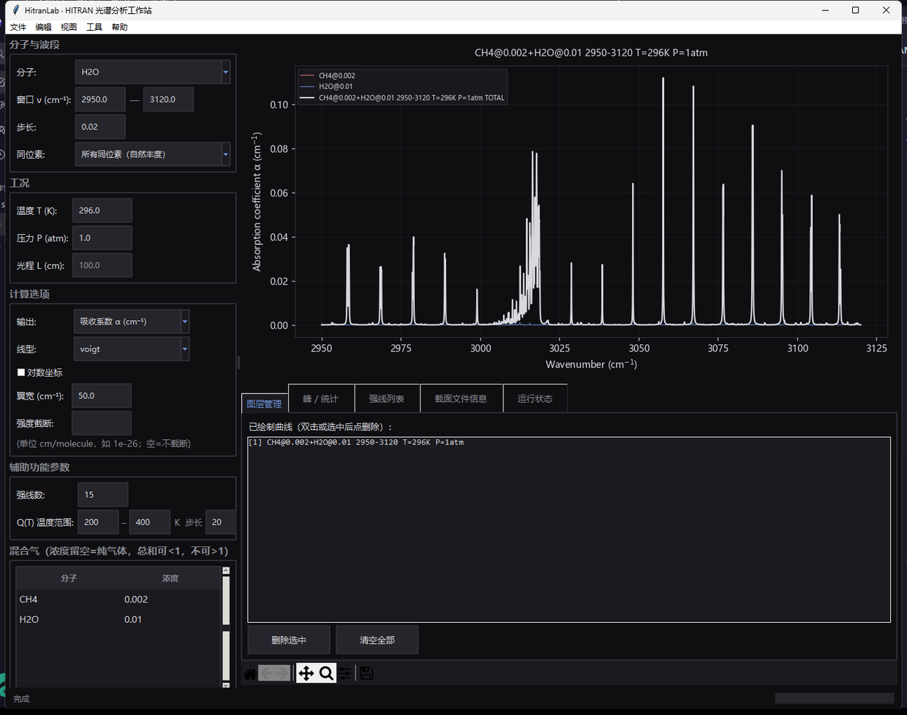
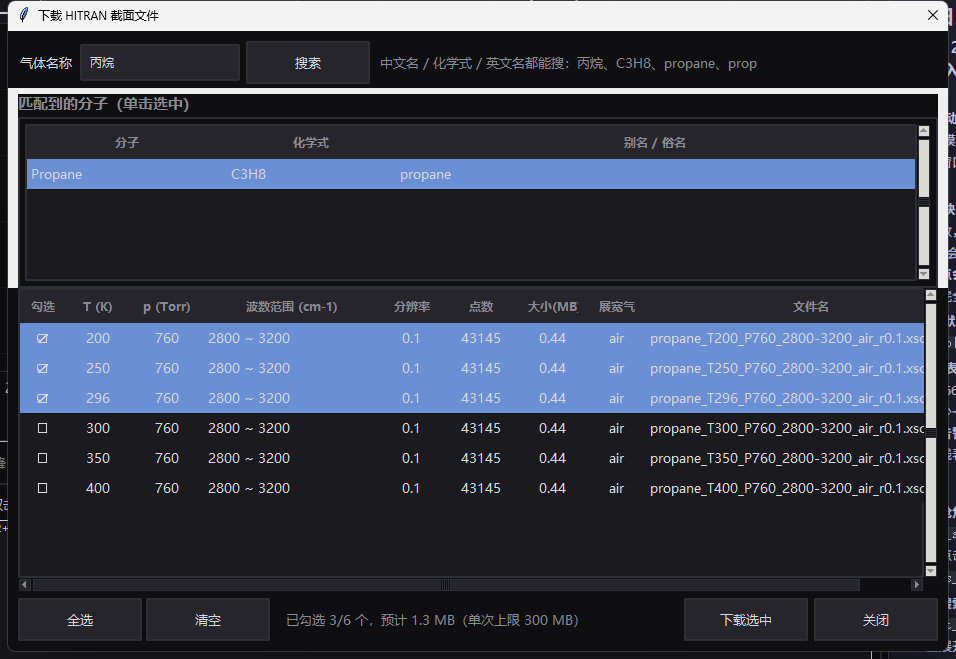

<div align="center">

<h1>hitran-mcp</h1>

<p><b>HITRAN 光谱数据库的 AI 工具链</b><br>
MCP 服务器 + HitranLink 桌面工作站 · 实时取数 · 本地缓存</p>

<a href="LICENSE"></a>
<a href="https://github.com/LKF0402/hitran-mcp/releases/latest"></a>
<a href="https://github.com/LKF0402/hitran-mcp/releases"></a>


<a href="https://github.com/LKF0402/hitran-mcp/stargazers"></a>
<a href="https://github.com/LKF0402/hitran-mcp/issues"></a>


[](https://github.com/LKF0402/hitran-mcp/actions/workflows/ci.yml)

</div>

[English](./README.en.md) | 中文

---

## 🚀 三秒上手

**两条路，选一条即可，都是开箱即用。**

| 方式 | 你要准备什么 | 花多久 |
|---|---|---|
| 🤖 **让 AI 装**（推荐） | 一个能执行本地命令的 AI 客户端 | 一句话 |
| 🖥️ **下载桌面版** | Windows x64，不用装 Python | 双击即用 |

### 🤖 A · 把这段话贴给 AI

> 前提：你的 AI 助手能在本机执行命令（Claude Code / Cursor / Codex / Cherry Studio 本地模式等）。

```text
我在这台电脑上用 hitran-mcp（HITRAN 光谱工具），请帮我装好并跑通，按顺序执行：
1. 检查 Python 是否 ≥ 3.10；如果不是，告诉我该装哪个版本，不要改动系统里其他组件
2. 克隆 https://github.com/LKF0402/hitran-mcp 到固定目录（已存在则更新），在该目录执行 pip install -r requirements.txt
3. 运行 python tools/hitran_mcp.py --selftest，把结果原样贴给我
4. 如果你的环境支持 MCP 客户端配置，按仓库 README「接入 MCP 客户端」把它注册为 MCP 服务器；不支持就跳过，改用命令行入口 python tools/hitran_cli.py
5. 用命令行跑一个例子验证：python tools/hitran_cli.py t_spectrum --name CH4 --mole_frac 0.002 --numin 2950 --numax 3100 --T 296 --P 1.01325
6. 最后用三句话告诉我：以后我能直接用自然语言问什么、数据缓存在哪里、出错时该看哪条信息
```

装完你就可以说人话：**「算一下 CH₄ 在 2968 cm⁻¹ 附近的吸收谱并画图」**

### 🖥️ B · 下载即用（无需 Python）

[**⬇️ 下载最新版**](https://github.com/LKF0402/hitran-mcp/releases/latest) → 解压 → 双击 `HitranLink.exe` → 选分子和参数 → 点「计算并绘图」。

> 💡 **不装 MCP 也能用**：客户端能执行本地命令时，AI 直接调 `python tools/hitran_cli.py ...`，同一套引擎、同样结果；纯网页对话才必须走 MCP。

## 📸 效果预览

**HitranLink 桌面工作站** —— CH₄ + H₂O 混合气吸收谱（CH₄ 2000 ppm、H₂O 1%，296 K、1 atm）：



**截面库在线检索与一键下载** —— 按中文名模糊匹配分子、勾选 T/P 工况后批量下载：



## ✨ 功能特性

| 特性 | 说明 |
|---|---|
| 全链路覆盖 | 物种查询 → 线表抓取 → 强线列表 → 吸收/透过率谱 → 谱图 → 配分函数 → 截面文件分析 |
| 双库桥接 | 逐线库走 HAPI 在线 API；截面库（600+ 重分子）走官方 API 在线检索 + 一键下载（免 Portal 登录），或读入本地文件，统一产物链路 |
| 物理防呆 | 混合气按 `α_i = x_i · α_pure_i(T, P, 浴气)`；窗口未覆盖自动重抓；0 线/失败显式报错，不静默出空谱 |
| 全程溯源 | 任何 CSV/PNG 均带 HITRAN2024 + HAPI + TIPS 版本水印，可追溯到原始文献 |
| 计算缓存 | 相同参数的谱计算结果自动缓存（200 条上限，LRU 淘汰），重复计算瞬时返回 |
| 桌面 GUI | HitranLink 工作站：多组分叠加绘图、图层管理、强线列表（标注分子来源）、Q(T) 曲线、波长↔波数换算器、截面文件在线搜索与下载、CSV/PNG 导出 |
| 安全更新 | 「帮助 → 检查更新」：下载地址按固定仓库 + 固定资产名构造，强制 SHA-256 与大小双校验，逐条安全解压 + 顶层白名单，旧资产缺摘要则拒绝自动升级 |
| 质量门禁 | 23 项离线单元测试、MCP 契约检查、安全/敏感性扫描；CI 三版本矩阵 + 独立 security job；依赖精确锁定 + Dependabot 周检 |
| 零数据入库 | 缓存、产物、个人下载的截面文件、打包产物全部 gitignore，仓库保持轻量 |

## 🧭 三种用法怎么选

| 你是 | 用哪条 | 入口 |
|---|---|---|
| 只想算谱看图 | 桌面版 | `HitranLink.exe` |
| 用 AI 对话做计算 | MCP 服务器 | 下面折叠块「接入 MCP 客户端」 |
| AI 能跑命令、但不想配 MCP | 命令行 | `python tools/hitran_cli.py --list` |

三者共用同一套引擎（`tools/hitran.py`），结果一致。

## 📖 项目概览

一套物理引擎（`tools/hitran.py`，官方 HAPI 1.3.0.0）支撑三种用法：MCP 服务器、命令行入口、桌面工作站——同一组参数，同一份结果。

数据实时取自 HITRANonline 双库（逐线 + 截面）；缓存、产物、截面文件、打包产物全部走 `.gitignore`，仓库只留代码与文档。

<details>
<summary><b>🤖 接入 AI（MCP / 命令行）</b></summary>

#### ⚙️ 从源码装（MCP）

##### 环境要求

- Python ≥ 3.10
- 依赖：`hitran-api`（官方 HAPI）、`numpy`、`matplotlib`（仅绘图/计算时惰性加载）

##### 安装

```bash
git clone https://github.com/LKF0402/hitran-mcp.git
pip install -r hitran-mcp/requirements.txt
```

或将仓库置于任意固定路径（下文以 `D:\hitran-mcp\` 为例）。

##### API Key（可选）

**桌面 GUI**：HitranLink → 工具 → 配置 API key → 输入并保存（自动同步到 `Hitran_Data/hitran_api_key.txt` 和 HAPI2 `config.json`）。

**命令行/MCP**：到 [hitran.org](https://hitran.org) 注册账号获取 API key，写入 `tools/hitran_api_key.txt`（与 `hitran_mcp.py` 同目录），或设置环境变量 `HITRAN_API_KEY`。

> 说明：配置 key 后，线表下载走 HITRAN 官方 v2 API（URL 携带 key），截面文件清单（`/api/v2/<key>/cross-sections`）与下载也需要它；未配置时自动回退 HAPI 1.x 旧接口（该接口不校验 key）。官方对 fetch 有每日配额，超限返回 403；本工具自动复用缓存，不重复下载。

#### 🤖 接入 MCP 客户端

任意支持 MCP 协议的客户端均可。将 `mcp.config.example.json` 的内容合入客户端配置（通常位于设置中的 MCP/工具管理），并**替换为你的实际路径**：

```json
"hitran": {
  "command": "python",
  "args": ["D:/hitran-mcp/tools/hitran_mcp.py"],
  "type": "stdio",
  "timeout": 600000,
  "disabled": false
}
```

**Windows 用户注意**：`python` 经常不在 PATH（或指向 Microsoft Store 空壳）。
> 先在终端运行 `where python` 验证；找不到就填解释器完整路径（如 `C:/Users/<用户名>/AppData/Local/Programs/Python/Python310/python.exe`）。

保存后重启客户端，看到 `hitran` 服务器与多个工具即接入成功。

#### ⌨️ 命令行入口（不装 MCP）

`tools/hitran_cli.py` 把同一批工具函数暴露成命令行，不需要注册 MCP 服务器。任何能执行本地命令的 AI 助手（Claude Code、Cursor、Codex 等）或脚本都可以直接调用，算出的结果与 MCP 通道完全一致。

```bash
# 列出全部工具（名称、用途）
python tools/hitran_cli.py --list

# 查分子/同位素表
python tools/hitran_cli.py t_species --name CH4

# 取窗口内最强 5 条线（选线/干扰分析）
python tools/hitran_cli.py t_lines --name CH4 --numin 2960 --numax 2975 --top_n 5

# 算吸收谱（CH4 2000 ppm，2950-3100 cm⁻¹，296 K，1 atm）
python tools/hitran_cli.py t_spectrum --name CH4 --mole_frac 0.002 \
    --numin 2950 --numax 3100 --T 296 --P 1.01325

# 配分函数 Q(T)
python tools/hitran_cli.py t_partition_sum --name CH4 --T 300
```

- 工具名可写 `hitran_spectrum`（与 MCP 一致）或 `t_spectrum`（函数名）。
- 参数写法 `--键 值`，键名即函数参数名；数字、`true/false`、JSON 数组会自动识别。
- 结果以 JSON 打到 stdout（库日志走 stderr，不污染输出），加 `--out 结果.json` 可落盘。
- 改用 MCP 前无需任何迁移：两者调用的是同一套函数。

</details>

<details>
<summary><b>🖥️ 桌面工作站</b></summary>

HitranLink 是无需编程的光谱分析桌面应用，适合日常科研使用。

#### 下载与运行

**方式一：下载预编译版本（推荐）**

1. 前往 [GitHub Releases](https://github.com/LKF0402/hitran-mcp/releases) 下载最新版本的 `HitranLink-windows-x64.zip`
2. 解压到任意目录（路径建议不含中文和空格）
3. 双击 `HitranLink.exe` 即可运行

> 首次运行时会自动在程序同目录创建 `Hitran_Data/` 缓存目录，计算过的线表会自动缓存，下次无需重新下载。
>
> 若要让打包 GUI 与源码模式 MCP 共用同一份缓存和 API key，设置环境变量 `HITRAN_DATA_DIR` 指向同一个数据目录即可；「运行状态」页会显示实际缓存根与当前代理。
>
> 升级：程序内「帮助 → 检查更新」→ 自动下载并替换。下载地址由程序按固定仓库与固定资产名自行构造，校验 GitHub 提供的 SHA-256 与文件大小后才解压，并只接受顶层 `HitranLink.exe` + `_internal` 的结构；最新资产缺少摘要时拒绝自动升级，改为提示手动下载（详见下方「🔒 安全与隐私」）。

**方式二：从源码运行**

```bash
git clone https://github.com/LKF0402/hitran-mcp.git
cd hitran-mcp
pip install -r requirements.txt
python app/hitran_app.py
```

#### 功能说明

| 功能模块 | 说明 |
|---|---|
| 谱计算 | 支持吸收系数 α、截面 σ、线强 S(296K)、透过率 T 四种输出模式 |
| 多组分叠加 | 默认叠加绘图，可叠加多个分子/不同工况的谱线，图层可单独删除 |
| 强线列表 | 显示窗口内最强 N 条谱线（ν、S、γ_air、E″），多分子合并时标注每条线来源分子 |
| Q(T) 曲线 | 配分函数随温度变化曲线，用于评估温度对线强的影响 |
| 配分函数 | 查询指定温度下的 Q(T) 值（TIPS-2025） |
| 截面文件 | 在线按中文名/化学式检索截面分子并一键下载（免 Portal 登录），读入原生 .xsc / 两列 .txt，绘图并导出溯源 CSV |
| 换算工具 | 波长 ↔ 波数实时换算器 |
| 分子表查询 | HITRAN 官方 61 种逐线分子表查询 |
| 数据导出 | 谱图 PNG（300 DPI）、谱数据 CSV（带溯源水印）、完整线表 CSV |
| 计算缓存 | 相同参数计算结果自动缓存，重复计算瞬时返回 |
| 自动更新 | 「帮助 → 检查更新」：固定仓库 URL、SHA-256 + 大小双校验、安全解压与顶层白名单 |

**操作流程**：
1. 选择分子（可多选混合气）、波数窗口、温度、压力、步长
2. 选择输出模式（吸收系数/截面/线强/透过率）
3. 点击「计算并绘图」
4. 可继续调整参数再次计算，谱线会自动叠加到同一画布
5. 点击「清空图」重置画布，点击「导出 CSV/PNG」保存结果

#### 从源码打包 / 发版

**推荐使用一键发布脚本** —— 它把"打包 exe"与"生成 zip 资产"绑成一步，并自动校验一致性：

```bash
pip install pyinstaller
python tools/build_release.py
```

脚本按顺序完成：

1. 依据 `HitranLink.spec` 打包 exe；
2. 替换 `dist/HitranLink/`（保留 exe 侧线表缓存与 `hitran_api_key.txt` —— 仅服务**发布者本机**，切勿直接分发 `dist/` 目录）；
3. 对打包产物跑一次无界面自检（分子数 / 谱点数 / 峰值 / 下载引擎）；
4. 生成 GitHub release 资产 `dist/HitranLink-windows-x64.zip`（**白名单式**：只含 `HitranLink.exe` + `_internal/`，API key / 缓存 / 日志一律不进 zip）；
5. **校验 zip 内的 exe 与 `dist/HitranLink/HitranLink.exe` 的大小与 CRC32 完全一致**
   —— 不一致直接报错退出。这样就不会再出现"zip 忘了重建、用户下载到旧版本"的问题。

可选参数：

```bash
python tools/build_release.py --zip-only      # 只重建 zip（沿用现有 dist）
python tools/build_release.py --no-selftest   # 跳过打包后的自检
```

打包目录约 245 MB（one-dir 模式，含 HAPI2 / sqlalchemy / numba / llvmlite），压缩后 zip 约 100 MB。发布时上传第 4 步生成的 zip 作为 release 资产即可。

> 打包前请关闭所有正在运行的 HitranLink 窗口，否则会因文件锁定失败（脚本会给出明确提示）。
>
> **不要手写 `pyinstaller` 命令**：`HitranLink.spec` 中包含 HAPI2 / sqlalchemy / numba /
> llvmlite / pyparsing 等必需依赖，手写参数极易漏掉，导致打包版 HAPI2 不可用。

</details>

<details>
<summary><b>🗂️ 仓库结构与打包</b></summary>

```
hitran-mcp/
├─ README.md                 # 中文文档（本文件）
├─ README.en.md              # English documentation
├─ docs/
│  ├─ images/                # README 配图（界面截图）
│  └─ QUALITY_AUDIT.md       # 分维度质量评估与敏感性检测报告
├─ CHANGELOG.md              # 更新日志
├─ SECURITY.md               # 安全政策与漏洞报告渠道
├─ LICENSE                   # GPLv3 协议
├─ requirements.txt          # Python 依赖（精确锁定版本）
├─ mcp.config.example.json   # MCP 客户端注册片段（改路径后合入你的配置）
├─ HitranLink.spec            # PyInstaller 打包规格
├─ .github/
│  ├─ workflows/ci.yml       # CI：三版本矩阵 + 单元/契约/安全 job
│  └─ dependabot.yml         # pip 与 Actions 依赖周检
├─ app/
│  ├─ hitran_app.py          # HitranLink 桌面工作站（Tkinter + matplotlib GUI）
│  ├─ updater.py             # 自动更新安全原语（URL 白名单/SHA-256/安全解压）
│  ├─ __init__.py
│  └─ hitranlink.ico          # 应用图标
├─ tests/
│  ├─ test_updater.py        # 更新链路单元测试
│  └─ test_core.py           # 脱敏、文件名防逃逸、状态字段测试
└─ tools/
   ├─ hitran_mcp.py          # MCP 服务器本体（stdio JSON-RPC，纯标准库）
   ├─ hitran_cli.py          # 命令行入口（不装 MCP 也能调用同一批工具函数）
   ├─ hitran.py              # 官方 HAPI 的统一薄封装（输入护栏 + 溯源水印 + 计算缓存）
   ├─ contract_check.py      # 离线契约检查（12 工具 / 协议 / BOM）
   ├─ security_check.py      # 安全与敏感性扫描（发布前闸门）
   ├─ build_release.py       # 一键打包 + 出 zip + 一致性校验 + 安全闸门
   └─ __init__.py
```

运行期自动生成（可随时删除，由工具重生）：

- `Hitran_Data/` — 线表缓存
- `tmp/mcp_out/` — MCP 工具产物（CSV/PNG，自带溯源水印）
- `tmp/` — 桌面工作站临时文件与自测输出
- `xsc_data/` — 用户按需下载的截面文件（个人数据，不入库）
- `dist/` / `build/` — PyInstaller 打包产物（不入库）

</details>

<details>
<summary><b>🧱 数据架构</b></summary>

HITRAN2024 采用**双库分发架构**，两条数据通道的访问机制不同——这也是"某物种在逐线工具中查不到"的根因。

#### 逐线库（LBL）

- 覆盖 **61 种分子**（H₂O / CO₂ / CH₄ / C₂H₆ / N₂O…）及 130+ 同位素体，数据为**逐跃迁线参数**（ν, S, γ_air, E″…）。
- 存储于 HITRANonline 关系型数据库，经官方 **HAPI**（HITRAN Application Programming Interface，Kochanov et al., JQSRT 177, 15–30, 2016）**在线 API** 提供——对应本 MCP 的 `hitran_fetch / lines / spectrum / plot` 通道：实时取数、本地缓存、可复现。

#### 截面库（XSC）

- 覆盖 **600+ 重分子**（烷烃、VOC、制冷剂等）：多为稠密振动带结构、缺乏逐线验证参数，以**测量光谱文件**收录——原生 `.xsc`（1 行定宽头 + σ 序列，单位 cm²/molecule）或两列 ν–σ 文本（单位 cm⁻¹ / cm²·molecule⁻¹）。
- 访问机制：官方 v2 API（`/api/v2/<key>/cross-sections`）提供**文件清单**，公开数据路径 `/data/xsec/` 提供**文件本体**，二者均可直接访问、**无需登录 Web Portal**（需本机配置 HITRAN API key）。HAPI 1.x 侧仅提供 `read_hotw()` 本地读文件接口。

#### 双库桥接

- 逐线通道（逐跃迁参数）与截面通道（测量光谱）是两套数据结构，HITRAN 官方分开分发；本工具把它们统一到同一条产物链路。
- **一键下载（推荐，免 Portal 登录）**：
  1. `hitran_xsc_molecules(query="丙烷")` 检索分子并拿到 `id`（支持中文名/化学式/英文名/俗名）；
  2. `hitran_xsc_files(molecule_id=<id>)` 列出可直接下载的文件（T/P/波数范围/点数/体积）；
  3. `hitran_xsc_download(name=..., filenames=[...])` 下载到 `xsc_data/`（gitignore，不入库；默认上限 300 MB）；
  4. `hitran_cross_section(file_path=...)` 读入，完成截窗、绘图、溯源 CSV 导出，与逐线谱共用 `tmp/mcp_out/` 产物链路。
- **手动下载（无 API key 时）**：`hitran_xsc_search(name=...)` 免登录探测清单 → 至 hitran.org/xsc 下载文件放入 `xsc_data/` → `hitran_cross_section` 读入。
- 逐线工具遇到截面库收录的分子时，报错信息会显式提示该架构差异与正确路径。

</details>

<details>
<summary><b>📋 工具参考（12 个）</b></summary>

| 工具 | 用途 | 关键输入 |
|---|---|---|
| `hitran_species` | 官方分子表：分子号 M、主同位素、各同位素自然丰度与质量 | `name`（分子式或分子号，省略返回全表） |
| `hitran_fetch` | 抓取波数窗口线表到本地缓存；未覆盖窗口自动重抓 | `name`, `numin`, `numax`, `iso` |
| `hitran_lines` | 窗口内最强 N 条线（ν、S、γ_air、E″），选线/干扰分析 | `name`, `numin`, `numax`, `top_n` |
| `hitran_spectrum` | 吸收系数 α / 透过率谱，CSV 带溯源水印；多物种可用 `specs_csv` 一次叠加 | `specs_csv` 或 `name`；`numin`, `numax` 必填 |
| `hitran_plot` | 谱图 PNG（多物种叠加 + 总谱，`ylog` 可选） | 同 `hitran_spectrum`，另加 `title/ylog/dpi` |
| `hitran_partition_sum` | 配分函数 Q(T)，TIPS 2025/2021/2017/2011 可选 | `name` 或 `M`；`T` |
| `hitran_cross_section` | 读入本地截面文件（原生 `.xsc` 或 ν–σ 两列）→ 截窗/绘图/溯源 CSV | `file_path`（缺省时列出 `xsc_data/` 可用文件） |
| `hitran_xsc_search` | 在线探测截面子库分子的截面文件清单（免登录只读，无文件名） | `name`（Portal 显示名） |
| `hitran_xsc_molecules` | 截面分子检索：中文名/化学式/英文名/俗名模糊匹配，返回候选与 `id`（约 670 个分子） | `query`（留空列全部）；`limit` |
| `hitran_xsc_files` | 列出某截面分子**可直接下载**的文件清单（T/P/波数范围/分辨率/点数/体积估算/filename，需 API key） | `name` 或 `molecule_id`；`include_all` |
| `hitran_xsc_download` | 选定文件下载到 `xsc_data/`（官方 API + 公开数据路径，免 Portal 登录，默认上限 300 MB） | `name`, `filenames`/`ids`；`dry_run`, `overwrite`, `max_total_mb` |
| `hitran_apikey_status` | API key / 缓存 / 产物 / 截面文件状态速查 | — |

多物种叠加示例（`specs_csv`，与 `name` 互斥）：

```
hitran_spectrum(specs_csv="CH4:0.01,C2H6:1e-5", numin=2950, numax=3120, T=296, P=1.0)
```

</details>

<details>
<summary><b>📏 使用规范与安全</b></summary>

#### 📏 使用规范

1. **单位**：默认返回吸收系数 α（cm⁻¹）；`hitran_units=true` 返回截面 σ（cm²/molecule，不按摩尔分数缩放）。
2. **混合气**：按 `α_i = x_i · α_pure_i(T, P, 浴气)` 计算，不使用 `x·P` 作为分压；未提供浓度时按纯气体计算并提示确认。
3. **参数澄清**：未给出参数使用默认值并如实列出（`needs_confirm=true` 时需向用户复核 T/P/窗口/浓度）；`strict=true` 时 T/P 缺失直接报错。
4. **线型**：`profile` 可选 voigt（默认）/ lorentz / gauss / doppler / ht / sdvoigt，全部直调官方 HAPI 谱函数。
5. **溯源**：任何 CSV/图均可追溯至 HITRAN2024（Gordon et al., JQSRT 2026, doi:10.1016/j.jqsrt.2026.109807）+ HAPI（Kochanov et al., JQSRT 2016）+ TIPS 版本；论文引用以返回的 citation 字段为准。
6. **同位素口径**：默认主同位素（纯气体权重 1.0）；`iso="all"` 按官方自然丰度加权。

#### 🔒 安全与隐私

**数据面**：本项目只做 HITRAN 取数与本地光谱计算，不采集遥测、不上报使用数据；唯一的凭据是 HITRAN API key。

**凭据存放**：API key 只落在运行期数据目录（`Hitran_Data/hitran_api_key.txt`，已 gitignore）。查询优先级为环境变量 `HITRAN_API_KEY` > `tools/hitran_api_key.txt` > `Hitran_Data/hitran_api_key.txt`。发布 ZIP 不含 key、缓存与日志。

**自动更新**：

- 下载地址由程序按 `LKF0402/hitran-mcp` + 固定资产名 `HitranLink-windows-x64.zip` 构造，不信任 API 返回的任意链接；只接受 `https://github.com/...` 前缀，拒绝 http、异域主机与查询串。
- 下载时边写边算 SHA-256，同时校验 GitHub 提供的 `digest` 与 `size`；任一不符即删除半截文件并中止。
- 解压逐条拒绝绝对路径、盘符、`..`、符号链接与加密条目，限制条目数（20000）与解压总量（700 MB）；顶层只允许 `HitranLink.exe` 与 `_internal`。
- 旧版本资产若没有 `digest`，程序拒绝自动升级并提示手动下载——这是有意的安全降级。

**发布闸门**：`tools/build_release.py` 在出包前调用 `tools/security_check.py`，扫描跟踪文件、Git 历史、工作区与发布 ZIP 中的凭据/个人路径/危险调用，出现阻断项直接拒绝出包；CI 另设独立 security job 复查。

**已知限制**：Windows 二进制未做代码签名，首次运行可能出现 SmartScreen 提示。

漏洞报告方式见 [SECURITY.md](SECURITY.md)。

</details>

<details>
<summary><b>✅ 测试与质量门禁</b></summary>

| 检查 | 命令 | 覆盖范围 | 期望 |
|---|---|---|---|
| 单元测试 | `python -m unittest discover -s tests -v` | 更新地址白名单、SHA-256、安全解压（`../`、绝对路径、盘符、zip bomb、符号链接）、顶层白名单、脱敏与文件名防逃逸 | 23/23 通过 |
| MCP 契约 | `python tools/contract_check.py` | 12 个工具的 `TOOLS`/`DISPATCH` 一致性、schema 必填、`initialize`/`tools/list`/`ping` 返回、无 UTF-8 BOM | `{"ok": true, "tools": 12, "version": "1.6.2"}` |
| 安全/敏感性 | `python tools/security_check.py` | 跟踪文件、Git 历史、工作区、发布 ZIP、Python AST 危险调用、依赖锁定、`.gitignore` 覆盖 | `"ok": true`、`issues: []` |
| MCP 联网自测 | `python tools/hitran_mcp.py --selftest` | 真实抓取 CO 小窗口并出图，另含截面链路（合成文件）、在线探测与状态检查 | 全链路成功 |
| 桌面工作站自测 | `python app/hitran_app.py --selftest selftest.json` | 引擎 + 数据 + 网络在打包环境内可用，输出分子数、谱点数、峰值、warnings | `warnings: []` |

CI（`.github/workflows/ci.yml`）在 Windows 上跑 Python 3.10/3.11/3.12 三版本矩阵：语法编译、`pyflakes` 静态检查、单元测试、契约检查；另有 `fetch-depth: 0` 的 security job 扫描 Git 历史。依赖在 `requirements.txt` 精确锁定（`hitran-api==1.3.0.0`、`numpy==2.0.1`、`matplotlib==3.9.1`），由 Dependabot 每周检查更新。

分维度评分与敏感性检测明细见 [docs/QUALITY_AUDIT.md](docs/QUALITY_AUDIT.md)。

</details>

<details>
<summary><b>❓ 常见问题</b></summary>

- **抓取失败 "daily limit"**：官方每日配额超限，次日重试；缓存未删时大部分窗口无需重新抓取。
- **报错 "Cannot connect to http://hitran.org" 或"无法抓取"，但该分子在此窗口明明有吸收**：这是**联网失败**，与"该窗口无收录线"无关。最常见原因是环境变量 `HTTP_PROXY` / `HTTPS_PROXY` 指向的代理不可用（例如 VPN 关闭时的 `127.0.0.1:7892`）——开启代理/VPN，或清空该环境变量走直连后重试即可（联网恢复后会自动重抓）；已缓存过的分子/窗口可离线计算。
- **修改代码不生效**：重启 AI 客户端（MCP 进程随客户端启动）；桌面工作站需重启程序。
- **清理缓存**：删除 `Hitran_Data/*.data|*.header` 即可，需要时自动重抓。
- **截面库分子（如丙烷 C₃H₈）查不到**：该分子属截面库，与逐线库分开分发。用 `hitran_xsc_molecules` 检索 → `hitran_xsc_files` 列清单 → `hitran_xsc_download` 一键下载，再用 `hitran_cross_section` 读入；无 API key 时可按[双库桥接](#双库桥接)流程手动下载。
- **exe 被杀软误报**：PyInstaller 打包的 Python 程序偶有误报，可添加信任或从源码运行。
- **列截面清单报 HTTP 500 / "查询失败"**：这是官方 `/api/v2/` 接口的服务端故障（实测该接口对**无效 key 与正常 key 都返回 500**，所以 500 不能说明你的 key 有问题；免登录的在线探测 `hitran_xsc_search` 通常仍可用）。请稍后重试，或到 [hitran.org/xsc](https://hitran.org/xsc) 登录后手动下载截面文件放进 `xsc_data/`，再用 `hitran_cross_section` 读入。

</details>

## 🔗 相关项目

- **[SpectroLink](https://github.com/LKF0402/spectrolink)**：多技术光谱传感仿真 MCP 总入口，覆盖 TDLAS-DA/WMS、LITES、CRDS、NDIR、FTIR、DOAS 六类技术。独立仓库、独立维护；与本项目不重叠——本项目负责 HITRAN 取数与逐线/截面计算，需要某类传感技术的端到端仿真（调制系数 m、谐波、检测限、腔衰荡时间等）时可直接接入。

## ⚖️ 免责声明

本软件按"现状"（AS IS）提供，作者不对使用本软件产生的任何直接或间接损失承担责任。

- 本软件仅供科研、教育和学习用途，不构成任何专业建议或产品承诺。
- 本项目与 macOS 应用 `HitranLab` 及其开发者、与 HITRAN 官方数据库及其团队均无关联，也未获其授权或背书。
- 光谱计算结果基于 HITRAN 数据库和 HAPI 库，可能存在数据更新延迟、计算近似或误差。
- 用户应自行验证计算结果的准确性，关键应用场景请以官方数据和专业软件为准。
- 作者不保证软件无缺陷、不中断或满足特定需求。
- 使用本软件即表示您同意自行承担使用风险。

## 📄 许可证

本项目采用 **GPLv3** 许可证，详见 [LICENSE](LICENSE)。

## 📚 References

- https://github.com/hitranonline/hapi
- https://github.com/hitranonline/hapi2
- https://github.com/hitranonline/hapiest
- https://hitran.org
